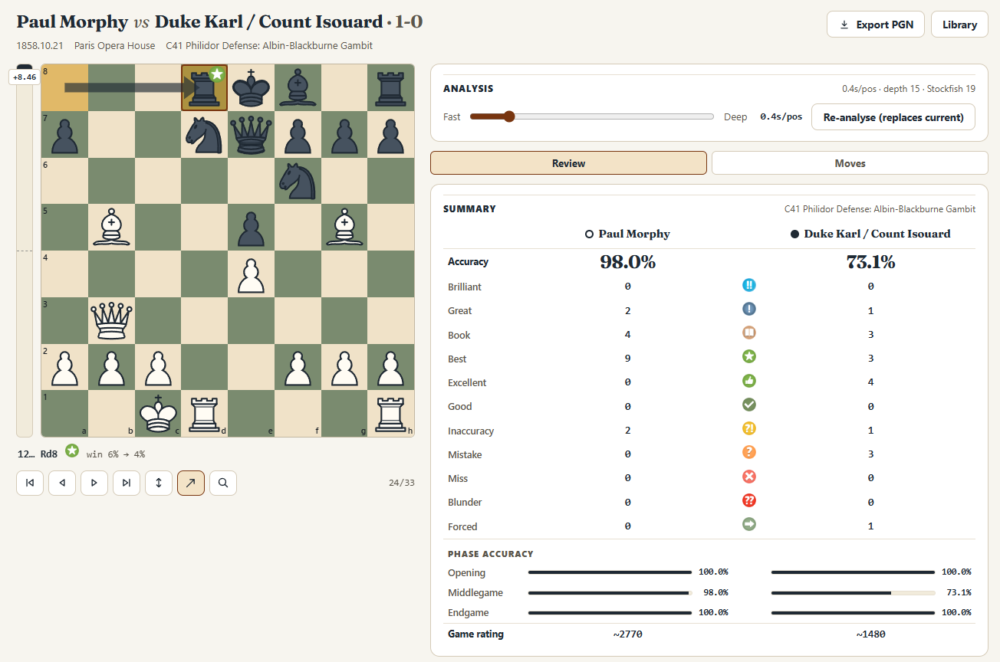

# Chess Review

Chess Review is a local chess game review tool. It runs on Windows, macOS and Linux. Paste a PGN or import games from chess.com or lichess, run Stockfish over every position, and read the result as a move-by-move review with labels, accuracy, an estimated game rating, key moments and an evaluation graph. Games and analyses live in a SQLite file on your machine, and the engine runs as a local process.



## What it does

- Imports one game or a multi-game PGN from text or a file, plus recent games from chess.com and lichess. PGNs that start from a FEN position work too.
- Labels every move as Brilliant, Great, Best, Excellent, Good, Book, Inaccuracy, Mistake, Miss, Blunder or Forced.
- Computes accuracy and an estimated game rating for both players, plus accuracy for the opening, middlegame and endgame.
- Draws an evaluation graph and collects up to ten key moments from the largest swings.
- Shows engine lines and an evaluation bar. It draws the engine's best move as one arrow.
- Offers an opening explorer with Masters, Lichess and a bundled offline book.
- Lets you play moves on the board against Stockfish in Explore mode. Chess Review keeps the line on the page and does not save it.
- Exports an annotated PGN with labels, evaluations, clocks and standard annotation glyphs, or NAGs.
- Stores games, analyses and settings in `data/chess-review.db`. Chess Review has no cloud service.

Chess Review is built for review, not play. It does not play human opponents and does not use tablebases.

## Requirements

- Node.js 20 or newer.
- Windows for the automated setup. On macOS or Linux, install Stockfish yourself and point the app at the binary.
- About 150 MB of disk space for the engine and opening book.
- Internet access for the first setup. After that, only the chess.com and lichess importers and the online opening explorer need a network.

## Quick start on Windows

Double-click `start.bat`. On the first run it installs dependencies, downloads Stockfish and the opening book, and builds the web UI. Then it starts the server and opens `http://localhost:3001`.

The same steps from a terminal:

```
npm install
npm run setup
npm run build
npm start
```

Then open `http://localhost:3001`.

`npm run setup` downloads the latest Windows x86-64 Stockfish build, runs a UCI smoke test, and fetches the lichess opening book. It is safe to re-run. Use `npm run setup -- --force` to download everything again.

## Run it on macOS or Linux

The setup script fetches a Windows build. Install Stockfish with your package manager or from the [Stockfish releases page](https://github.com/official-stockfish/Stockfish/releases), then run:

```
npm install
export STOCKFISH_PATH=/path/to/stockfish
npm run build
npm start
```

The opening book is optional. Create `vendor/openings` if needed, then copy `a.tsv` through `e.tsv` from `lichess-org/chess-openings` into it to enable Book labels and the Local book tab. Without the book, analysis still runs, and the other labels come from the engine alone.

## Run it in development

```
npm install
npm run setup
npm run dev
```

On macOS or Linux, skip `npm run setup` and export `STOCKFISH_PATH` first.

The API runs on `http://localhost:3001` and Vite serves the UI on `http://localhost:5173`. Vite proxies `/api` to the server. Changes to server code restart the API, and changes to the web UI reload the page.

To build the production UI, run `npm run build`. `npm start` serves the built files from `web/dist` on port 3001. If `web/dist` is missing, the server prints build instructions instead of the app.

## Review a game

1. Open the Library and choose Import game.
2. Paste a PGN, pick a `.pgn` file, or load recent games from chess.com or lichess by username.
3. Parse the input, select a game and choose Analyse this game. The analysis starts automatically after import.
4. Set the search budget with the depth slider, then read the summary, evaluation graph and key moments under Review, and the score sheet or opening explorer under Moves.
5. Use the board controls to step through the game. Explore mode lets you try another move and see the engine's lines from the new position.
6. Choose Export PGN from the review page or the library to download the annotated game.

A full game at the default 0.25 seconds per position takes roughly half a minute. Re-analysing a game at a new depth replaces the stored analysis. Closing the page during a run cancels the run.

The chess.com importer reads the last two monthly archives and returns up to 40 games. The lichess importer returns up to 40 recent standard games. Both need internet access. The online opening explorer also needs a free lichess token, which you can add under Settings.

## How analysis works

Stockfish evaluates every position in the game, including the start position. MultiPV is 3 by default, so the engine keeps three candidate lines. The server turns centipawn scores into win chances with a logistic model, compares the position before and after each move from the mover's point of view, and labels the move. The analysis leaves Book and Forced moves out of accuracy. The server runs one search at a time, so the per-position budget sets the total run time.

Accuracy blends the weighted mean of per-move accuracy with the weighted harmonic mean, so repeated errors cost more than a single slip. The estimated game rating is a fixed accuracy-to-Elo table with linear steps between anchors. The formulas and thresholds live in `server/src/analysis`.

The opening book comes from `lichess-org/chess-openings`. A move counts as Book while it matches a line in the book and appears within the first 50 plies. Opening names come from the deepest matching book position.

The win-chance loss thresholds apply to moves other than the engine's top choice. Win points are percentage points on the win chance scale.

| Label | Rule |
| --- | --- |
| Brilliant | The engine's top move. It gives up at least 100 centipawns of material, about one pawn, and the mover's win chance is between 8% and 85% before the move. |
| Great | The engine's top move. It is at least 12 win points better than the best alternative, and the mover's win chance is at or below 92%. |
| Best | The engine's top move. |
| Excellent | The mover loses up to 2 win points. |
| Good | The mover loses up to 4 win points. |
| Book | The move matches the opening book within the first 50 plies. |
| Inaccuracy | The mover loses up to 8 win points. |
| Mistake | The mover loses up to 16 win points. |
| Miss | The mover had at least 62% win chance and fell to 50% or less, or missed a forced mate. |
| Blunder | The mover loses more than 16 win points. |
| Forced | Only one legal move was available. |

The classifier checks Forced and Book first. The other labels follow the decision tree in `server/src/analysis/classify.ts`.

## Settings

The Settings page controls these values:

- Default search time per position, shown as analysis depth in the UI. The options are 0.25, 0.5, 1, 1.5, 2.5, 4, 6 and 10 seconds.
- Engine threads. The default is half the CPU cores, capped at 8.
- Hash size in MB. The default is 256.
- Stockfish binary path. Leave it empty to use the bundled copy.
- Lichess API token for the online opening explorer. The Local book tab works without it.

Settings take effect on the next analysis. Changing threads, hash or the engine path causes the engine to restart on the next search.

These environment variables override the defaults:

- `PORT` sets the API and production web port. The default is 3001. The Vite dev proxy expects 3001.
- `CHESS_REVIEW_DB` sets the SQLite file path.
- `STOCKFISH_PATH` sets the engine binary. The app checks the path in Settings first, then `STOCKFISH_PATH`, then `vendor/stockfish/stockfish.exe` or `vendor/stockfish/stockfish`.
- `LICHESS_TOKEN` sets the initial explorer token.
- `OPEN_BROWSER=1` opens the browser on Windows when the server starts. `start.bat` sets it.

## Command line analysis

Analyse a game without the web UI:

```
npm run analyze -- samples/opera-game.pgn
npm run analyze -- samples/opera-game.pgn --movetime=1000 --multipv=3 --json
```

Options:

- `--movetime=250` sets milliseconds per position.
- `--multipv=3` sets the number of engine lines. The default is 3.
- `--index=0` picks a zero-based game from a multi-game PGN.
- `--json` prints the full analysis as JSON.

The CLI loads the opening book, prints per-move labels, accuracy, phase accuracy, label counts, key moments and the depth reached. It does not write to the database.

## Tests

```
npm run selfcheck
```

This runs the pure logic checks for sacrifice detection, the label decision tree, accuracy and rating maths, and PGN parsing. It does not start Stockfish.

## Data and privacy

- Games, analyses and settings live in `data/chess-review.db`. SQLite uses WAL mode, so the `-wal` and `-shm` files next to it are part of the database.
- Deleting a game removes its analysis too.
- To back up the library, stop the server and copy the database files.
- Chess Review does not upload games or analyses to a service of its own. The optional importers send a username to chess.com or lichess, and the online opening explorer sends the current position to `explorer.lichess.ovh`.
- The server has no login and listens on all network interfaces by default. Do not expose port 3001 to the internet. On a shared network, change `app.listen(PORT, ...)` in `server/src/index.ts` to `app.listen(PORT, '127.0.0.1', ...)`.
- Git ignores `data/`, databases, `.env` files, keys, `vendor/`, `web/dist/` and local design-tool artifacts.

## Project layout

```
server/               Express API, SQLite and the Stockfish process wrapper
server/src/analysis/  PGN parsing, move labels, accuracy, opening book and static exchange evaluation
web/                  React UI and Vite build
web/src/pages/        Library, Import, Review and Settings
scripts/setup.mjs     Downloads Stockfish and the opening book
samples/              Test PGNs
vendor/               Engine and opening book, created by setup
data/                 SQLite database, created on first start
docs/                 Screenshot
```

Third-party asset credits live in `web/CREDITS.md`.

## Troubleshooting

**The engine status says offline.** On Windows, run `npm run setup`. On macOS or Linux, set `STOCKFISH_PATH` to your Stockfish binary. Check that the engine file exists, then restart the server. You can also set the engine path in Settings.

**Analysis is slow.** Lower the depth slider. Reducing threads frees CPU for other work but does not make the analysis finish sooner.

**The online explorer returns 401.** The lichess explorer needs a token. Create a free token at `https://lichess.org/account/oauth/token/create`, leave the scopes empty, and paste it under Settings. The Local book tab works without a token.

**Port 3001 is already in use.** Set `PORT` to another value before `npm start`. If you change it, update the Vite proxy in `web/vite.config.ts` for development.

**Book moves are missing.** The opening book is optional. Run `npm run setup` on Windows, or create `vendor/openings` and copy `a.tsv` through `e.tsv` from `lichess-org/chess-openings` into it. Then restart the server.

**better-sqlite3 fails to install.** The package uses a native SQLite library. If npm cannot find a prebuilt binary for your Node version, install the platform build tools and run `npm install` again.

## Credits

- Stockfish, GPL-3.0, downloaded by the setup script.
- Opening book data from `lichess-org/chess-openings`, CC0.
- Move-class badges from WintrChess, GPL-3.0. See `web/CREDITS.md` for file hashes and license details.
- Fraunces typeface, OFL-1.1, self-hosted in `web/public/fonts`.
- chess.js, React, Vite, Express, better-sqlite3 and their dependencies keep their own licenses.

## License

Chess Review is released under the GNU General Public License v3.0. See [LICENSE](LICENSE).

The third-party assets listed under Credits keep their own licenses.
